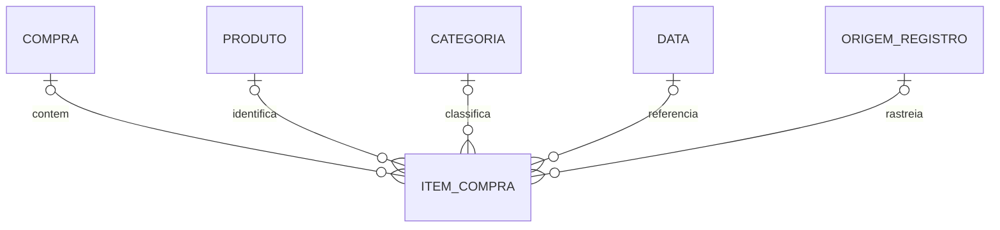

# 01 — Engenharia Reversa

## 1. Objetivo

Este documento registra o estado atual do projeto **Análise de Consumo de Mercado**, antes da evolução para uma arquitetura de Engenharia de Dados.

O objetivo da engenharia reversa é entender:

* como os dados são obtidos;
* como são armazenados;
* qual é a granularidade dos dados;
* quais transformações são realizadas;
* quais regras de negócio existem;
* quais limitações existem na arquitetura atual;
* quais pontos deverão ser evoluídos nas próximas versões.

Este documento representa a **V1 — estado atual do projeto**.

---

## 2. Contexto do projeto

O projeto foi inicialmente desenvolvido para registrar e analisar gastos com compras de supermercado.

Os dados são utilizados para gerar análises e indicadores relacionados a:

* gastos ao longo do tempo;
* produtos consumidos;
* categorias de produtos;
* frequência de compras;
* preços;
* quantidade;
* comportamento de consumo;
* análise de Pareto;
* evolução dos gastos.

A camada de visualização atual é construída no **Power BI**.

---

## 3. Fonte dos dados

### 3.1 Fonte principal atual

A fonte principal é uma planilha **Excel**, que acumula os registros históricos de compras.

O pipeline Python atual lê essa planilha Excel. Arquivos CSV não são aceitos como entrada por essa implementação; o CSV é produzido como saída da camada Bronze.

### 3.2 Origem dos dados

Os dados são obtidos a partir dos cupons/notas fiscais das compras.

Atualmente, a captura dos dados ainda não é automatizada.

O processo utilizado é:

1. O cupom fiscal é fotografado ou disponibilizado;
2. Os dados do cupom são extraídos manualmente/assistidos por OCR ou IA;
3. Os dados extraídos são revisados;
4. Os registros são copiados para a planilha Excel;
5. O Power BI utiliza a planilha como fonte para as análises.

Nem todas as compras possuem atualmente a imagem original do cupom fiscal.

---

## 4. Fluxo atual dos dados

A camada de análise do Power BI e o pipeline Python local são fluxos independentes no estado atual:

```text
Cupom / Nota Fiscal
        │
        ▼
Extração manual / assistida
        │
        ▼
      Excel
      ├──────────────────────┐
      ▼                      ▼
  Power Query          Pipeline Python
      │                      │
      ▼                      ▼
   Power BI            CSV da camada Bronze
      │
      ▼
   Dashboard
```

O modelo Power BI continua ligado à planilha Excel. Não há evidência de que o relatório consuma o CSV gerado pelo pipeline.

### Responsabilidades atuais

| Componente         | Responsabilidade                            |
| ------------------ | ------------------------------------------- |
| Cupom fiscal       | Fonte original das informações              |
| Extração manual/IA | Captura das informações do cupom            |
| Excel              | Armazenamento dos dados estruturados        |
| Power Query        | Limpeza e transformação                     |
| Power BI           | Modelagem, medidas, análises e visualização |
| Pipeline Python    | Padronização local e gravação do CSV Bronze |

### 4.1 Pipeline local Python

O módulo `src/market_pipeline/pipeline.py` implementa uma primeira etapa local de processamento:

1. Lê a aba `Mercado 03-2026` do arquivo Excel;
2. Normaliza nomes de colunas, preserva o número da linha Excel em `linha_origem` e seleciona/renomeia os campos esperados;
3. Converte quantidades e valores para números e a data para o tipo de data;
4. Ordena os registros por data e cria `produto_padronizado`, que por enquanto apenas remove espaços repetidos;
5. Separa linhas válidas e rejeitadas, registrando os motivos da rejeição;
6. Grava os registros válidos em `mercado_bronze.csv` e os rejeitados em `mercado_rejeitados.csv`.

Por padrão, os arquivos são gravados em `data/bronze/`. A Bronze contém `linha_origem`, `produto_descricao`, `categoria`, `quantidade`, `unidade`, `valor_unitario`, `valor_total`, `data_compra` e `produto_padronizado`. O arquivo de rejeitados mantém as colunas de origem lidas da planilha, acrescenta `linha_origem` e inclui `motivos_rejeicao`.

As verificações por linha cobrem descrição/categoria/unidade ausentes, descrição padronizada muito curta, quantidade/preços/total ausentes, inválidos ou não positivos e datas inválidas. O resultado informa linhas processadas, válidas e rejeitadas; `valid` é falso quando há rejeições. A Bronze válida ainda é gravada mesmo nesse caso, portanto consumidores devem verificar o indicador antes de usá-la. Linhas rejeitadas não são descartadas: ficam no CSV separado com seus valores originais e motivos. Arquivo vazio e colunas ausentes interrompem a execução.

Essa implementação não automatiza a captura dos cupons, não deduplica registros, não cria identificador de compra, não harmoniza unidades nem agrupa descrições em um catálogo de produtos. Também não substitui as transformações do Power Query nem está integrada ao relatório Power BI.

---

## 5. Estrutura atual dos dados

A tabela principal possui atualmente campos semelhantes aos seguintes:

| Campo                | Descrição                              |
| -------------------- | -------------------------------------- |
| Descrição do Produto | Descrição original do produto no cupom |
| Categoria            | Categoria atribuída ao produto         |
| Qtde                 | Quantidade comprada                    |
| Unid                 | Unidade de medida                      |
| Vlr Unit (R$)        | Valor unitário                         |
| Tot (R$)             | Valor total do item                    |
| Data Compra          | Data da compra                         |
| Dia de Semana        | Dia da semana derivado da data         |

---

## 6. Granularidade

A granularidade atual da tabela é:

> **1 linha representa 1 item/produto comprado.**

Exemplo:

```text
BANANA BRANCA KG
Quantidade: 0,755 KG
Valor unitário: R$ 6,49
Valor total: R$ 4,90
Data: 09/03/2026
```

Portanto, a tabela atual representa **itens de compra**, e não necessariamente uma compra completa.

---

## 7. Identificação de uma compra

Atualmente não existe um identificador confiável para cada compra/cupom, como:

```text
id_compra
id_cupom
id_nota
```

A data da compra está disponível, porém **não deve ser utilizada como identificador da compra**, pois podem existir múltiplas compras no mesmo dia.

Exemplo:

```text
25/03/2026 → compra A
25/03/2026 → compra B
```

Sem uma informação adicional, não é possível determinar automaticamente quais itens pertencem a cada compra.

### Situação atual

Para parte do histórico:

```text
id_compra = desconhecido
```

### Situação futura

Para novas compras capturadas automaticamente, o sistema deverá gerar um identificador único para cada cupom/compra.

---

## 8. Problemas identificados nos dados

### 8.1 Descrições inconsistentes

O mesmo produto pode aparecer com pequenas diferenças de formatação.

Exemplos:

```text
AGRIAO   HIDROPONICO DEVILE UN
AGRIAO HIDROPONICO DEVILE UN
```

ou:

```text
BANANA BRANCA KG
BANANA   BRANCA KG
```

Essas diferenças podem fazer com que o mesmo produto seja interpretado como produtos diferentes.

---

### 8.2 Produtos promocionais

Existem descrições como:

```text
BANANA BRANCA KG PROMOCAO
```

Enquanto outras ocorrências aparecem como:

```text
BANANA BRANCA KG
```

Para fins analíticos, pode ser necessário distinguir:

```text
produto_original
```

de:

```text
produto_padronizado
```

A descrição original deve ser preservada.

---

### 8.3 Valores monetários

Os valores precisam ser armazenados como valores numéricos, e não como texto formatado.

Exemplo atual:

```text
$4,06
```

Representação desejada no banco:

```text
4.06
```

A moeda e a formatação devem ser responsabilidades da camada de apresentação.

---

### 8.4 Dados derivados

O campo:

```text
Dia de Semana
```

pode ser derivado de:

```text
Data Compra
```

Portanto, futuramente deverá ser avaliado se esse atributo precisa ser armazenado na camada de origem ou se deve ser calculado em uma dimensão de calendário.

---

### 8.5 Ausência de fonte automatizada

A entrada de dados depende atualmente de:

```text
Cupom
  ↓
Extração
  ↓
Revisão
  ↓
Cópia para Excel
```

Esse processo possui intervenção manual e pode gerar:

* erros de digitação;
* inconsistência de formatos;
* duplicidade;
* perda de informações;
* dificuldade de rastreabilidade.

---

## 9. Dados históricos

O projeto possui histórico de compras armazenado em uma planilha acumulada.

Algumas compras possuem as imagens originais dos cupons, porém não existe atualmente uma imagem disponível para todas as compras históricas.

Por esse motivo, a futura arquitetura deverá ser capaz de trabalhar com:

1. dados históricos já estruturados;
2. novos dados provenientes de cupons;
3. registros cuja origem original não está mais disponível.

---

## 10. Principais limitações da arquitetura atual

### Armazenamento

* Dependência do Excel;
* ausência de banco de dados;
* ausência de controle estruturado de schema.

### Ingestão

* Processo manual;
* ausência de processamento sistemático dos cupons.

Existe uma pipeline Python local para processar a planilha Excel e gerar um CSV Bronze. A captura dos cupons continua manual/assistida, e a execução da pipeline ainda não é orquestrada.

### Qualidade

* Existem testes automatizados para os caminhos principais da pipeline; na última execução local, os 5 testes passaram;
* Existem verificações básicas no código, mas não uma estratégia formal de Data Quality;
* inconsistências de nomes de produtos;
* possibilidade de duplicidades.

### Rastreabilidade

Atualmente não existe uma estrutura completa para responder:

```text
De qual arquivo veio esse registro?
Quando ele foi ingerido?
Quem o alterou?
Ele foi corrigido?
Qual foi a transformação aplicada?
```

### Orquestração

Não existe atualmente uma ferramenta responsável por coordenar o pipeline.

### Observabilidade

Não existem mecanismos estruturados de:

* logging;
* monitoramento;
* alertas;
* métricas de pipeline.

---

## 11. Modelo conceitual — proposta

O modelo conceitual descreve os conceitos de negócio sem afirmar que eles já existam como tabelas físicas. A granularidade central permanece **um item de produto por registro**.

| Entidade | Significado | Observação |
| -------- | ----------- | ---------- |
| Compra | Conjunto de itens de uma compra/cupom | Não identificável com segurança para todo o histórico; não inferir pela data |
| Item da compra | Produto, quantidade, unidade e valores registrados em uma linha | Entidade central e granularidade observada na planilha |
| Produto | Identidade analítica do produto comprado | O agrupamento atual do Python só normaliza espaços; identidade ainda precisa ser definida |
| Categoria | Classificação usada na análise | Atualmente registrada como atributo da linha; regra de associação ainda precisa ser validada |
| Data | Data associada ao item e seus atributos de calendário | Dia da semana é derivável da data |
| Origem do registro | Arquivo e localização de onde veio a linha | A pipeline atual ainda não persiste metadados de linhagem |

Relacionamentos conceituais propostos:



O vínculo do item com compra, produto, categoria ou origem pode permanecer desconhecido quando a fonte não trouxer evidência suficiente. Em particular, `Data Compra` não é chave de compra: podem existir várias compras no mesmo dia.

## 12. Modelo lógico — proposta inicial

O modelo lógico abaixo é uma proposta para a V2, não o esquema implementado. As chaves técnicas deverão ser geradas na ingestão; elas identificam registros no sistema, mas não resolvem por si só a identidade de negócio de produtos ou compras históricas.

| Tabela | Chave proposta | Atributos principais | Regras e ressalvas |
| ------ | -------------- | ------------------- | ----------------- |
| `fato_item_compra` | `id_item` | `id_compra`, `id_produto`, `id_categoria`, `data_compra`, descrição original, quantidade, unidade, valor unitário, valor total, origem | Uma linha por item; `id_compra` e `id_produto` podem ser nulos enquanto não forem resolvidos |
| `dim_compra` | `id_compra` | identificador da compra/cupom, data e metadados disponíveis | Criar vínculo somente quando houver identificador confiável; não agrupar apenas pela data |
| `dim_produto` | `id_produto` | descrição canônica e atributos confirmados do produto | Manter descrição original no fato ou em estrutura de aliases; não deduplicar apenas por semelhança textual |
| `dim_categoria` | `id_categoria` | nome da categoria | Formalizar o domínio e validar se a categoria é estável por produto ou por item |
| `dim_data` | `data` | dia, mês, ano e dia da semana | Atributos de calendário derivados da data; compatível com análises temporais |
| `origem_registro` | `id_origem` | arquivo de origem, referência à linha e data de ingestão | Ainda não é produzido pela pipeline atual; necessário para rastreabilidade |

`quantidade` deve ser analisada junto com `unidade`; não somar valores de `KG` e `UN` como se fossem uma mesma medida. Valores monetários devem permanecer numéricos e a moeda deve ser explicitada na apresentação. O identificador `id_item` não deve ser usado para deduplicar linhas: a regra de duplicidade ainda precisa ser definida com base na fonte.

### Diferença para o modelo atual

O modelo semântico atual concentra os campos na tabela `Mercado` e possui uma relação com uma tabela local de datas gerada pelo Power BI. As dimensões acima ainda não estão materializadas, e a pipeline Bronze não alimenta o relatório atual.

## 13. Arquitetura V2 — proposta incremental

A próxima arquitetura deve evoluir a partir dos componentes existentes, mantendo o processamento local enquanto volume e operação não justificarem serviços adicionais.

```text
Excel (entrada manual atual)
          │
          ▼
Python: ingestão e preservação da origem        [parcialmente implementado]
          │
          ├── RAW: arquivo original + metadados [proposto]
          │
          ▼
BRONZE: esquema tabular padronizado             [CSV atual, inicial]
          │
          ▼
Qualidade: válidos + rejeitados com motivos     [regras básicas atuais]
          │
          ▼
SILVER: produtos/categorias resolvidos          [proposto]
          │
          ▼
Power BI                                        [hoje ainda lê o Excel]
```

| Etapa | Responsabilidade | Situação |
| ----- | ---------------- | -------- |
| Entrada | Receber a planilha Excel revisada; captura de cupom permanece manual | Atual |
| RAW | Preservar arquivo e metadados de origem para permitir auditoria e reprocessamento | Ainda não implementada |
| BRONZE | Padronizar nomes/tipos sem perder a descrição original | CSV local de linhas válidas; inclui `linha_origem`, mas não é uma cópia completa da fonte |
| Qualidade | Separar registros válidos e rejeitados, registrando motivos | Bronze válida e CSV de rejeitados são gravados separadamente; `valid=False` sinaliza rejeições, mas não bloqueia a gravação da Bronze |
| SILVER | Resolver aliases de produto e regras de categoria/unidade aprovadas | Ainda não implementada |
| Consumo | Disponibilizar dados validados ao relatório | Power BI ainda usa o Excel; integração com a saída Python pendente |

### Decisões adiadas

* **Banco de dados:** manter arquivos locais enquanto houver uma fonte e um consumidor; reavaliar quando houver múltiplos consumidores, necessidade de consultas concorrentes ou histórico operacional confiável.
* **Orquestrador:** não adotar enquanto a execução local manual for suficiente; reavaliar quando houver ingestão recorrente que precise de agenda, retentativa e alertas.
* **dbt:** considerar somente depois de existir um destino SQL com transformações que justifiquem esse framework.
* **Cloud e processamento distribuído:** adiar até existir requisito de disponibilidade remota, colaboração, escala ou segurança que o ambiente local não atenda.

Esses critérios substituem a seleção antecipada de ferramentas. A arquitetura deverá ser revista quando um requisito concreto mudar.

## 14. Regras iniciais de qualidade — proposta

As regras abaixo são critérios de desenho, não uma afirmação de que já estão implementadas. Regras de negócio que dependem de confirmação estão marcadas como provisórias.

| Verificação | Tratamento proposto | Observação |
| ------------ | ------------------- | ---------- |
| Arquivo legível, aba e colunas obrigatórias presentes | Falhar a execução antes de gerar saída | A pipeline atual já verifica a aba e as colunas esperadas |
| Data, quantidade e valores conversíveis | Rejeitar a linha com motivo e referência à origem | Implementado; a linha é gravada no CSV de rejeitados |
| Descrição, categoria e unidade não vazias | Rejeitar ou deixar em revisão, sem inventar valor | Ausências são rejeitadas; a regra final para categoria ainda precisa ser confirmada |
| Quantidade, valor unitário e total positivos | Verificar e sinalizar | Regra provisória: confirmar como representar devoluções, descontos e ajustes antes de rejeitar valores não positivos |
| Total compatível com quantidade × valor unitário | Sinalizar divergência para revisão | Definir tolerância para arredondamentos, descontos e pesagem; não bloquear até validar os dados |
| Unidade preservada junto à quantidade | Impedir agregações incompatíveis | Não somar `KG` e `UN` como uma medida homogênea |
| Possível duplicidade | Sinalizar sem remover automaticamente | Linhas iguais podem representar itens legítimos distintos |
| Linhagem da linha | Guardar arquivo, aba/linha e data de ingestão | `linha_origem` é preservada; arquivo, aba e data de ingestão ainda não são gravados em cada saída |

Os registros rejeitados permanecem consultáveis com os valores lidos da planilha, `linha_origem` e motivo. A execução informa contagens de entrada, válidos e rejeitados. A gravação da Bronze não é bloqueada por rejeições; o consumidor deve respeitar `valid=False`. Uma política explícita de publicação e linhagem completa ainda precisa ser definida.

---

## 15. Objetivos da evolução

A evolução do projeto deverá permitir:

* automatizar a ingestão;
* reduzir dependência de planilhas;
* armazenar dados de forma estruturada;
* preservar dados brutos;
* validar a qualidade dos dados;
* padronizar produtos;
* identificar compras individualmente quando possível;
* permitir reprocessamento;
* criar histórico das transformações;
* implementar testes;
* orquestrar pipelines;
* monitorar execuções;
* disponibilizar dados confiáveis para Analytics.

---

## 16. Princípios do projeto

Durante a evolução da plataforma serão adotados os seguintes princípios:

### Não alterar o dado bruto

A informação original deverá ser preservada sempre que possível.

### Não inventar informação

Quando não for possível determinar uma informação, ela deverá permanecer desconhecida ou nula.

### Automatizar progressivamente

A complexidade será adicionada conforme surgir necessidade real.

### Separar responsabilidades

Ingestão, transformação, qualidade, armazenamento e consumo devem possuir responsabilidades claras.

### Documentar decisões

Decisões arquiteturais relevantes deverão ser registradas no histórico arquitetural.

### Testar antes de confiar

Os dados e pipelines deverão possuir mecanismos de validação.

---

## 17. Estado atual

**Fase:** Engenharia reversa e primeira pipeline local

**Versão:** V1 — Power BI, com pipeline Python local inicial

**Status:**

* [x] Fonte identificada
* [x] Granularidade identificada
* [x] Fluxo atual documentado
* [x] Principais problemas identificados
* [x] Limitações arquiteturais identificadas
* [x] Pipeline Python local inicial
* [x] Testes automatizados básicos implementados
* [x] Regras básicas de validação implementadas
* [x] Modelo conceitual proposto e documentado
* [x] Modelo lógico proposto e documentado
* [x] Arquitetura V2 incremental proposta
* [x] Regras iniciais de qualidade documentadas
* [x] CSV de rejeitados com motivos implementado
* [x] Número da linha de origem preservado
* [ ] Banco de dados
* [ ] Linhagem completa por arquivo, aba e data de ingestão
* [ ] Estratégia formal de Data Quality implementada
* [ ] dbt
* [ ] Airflow
* [ ] Cloud
* [ ] CI/CD
* [ ] Observabilidade

---

## 18. Próximos passos

1. Validar o modelo conceitual e lógico com as regras de negócio e com os dados de origem;
2. Definir como identificar compras futuras e como representar compras históricas sem identificador;
3. Definir regras de identidade, aliases e duplicidade para produtos;
4. Completar metadados de linhagem por arquivo, aba e data de ingestão;
5. Implementar e testar as regras de qualidade após validar as regras de negócio provisórias;
6. Definir a política de publicação quando houver rejeições e garantir que consumidores respeitem `valid`;
7. Definir a integração da camada validada com o Power BI e reconciliar os resultados com o relatório atual;
8. Evoluir a execução local com rastreabilidade e reprocessamento reproduzível;
9. Reavaliar banco, orquestração e cloud somente quando os critérios documentados forem atendidos.
